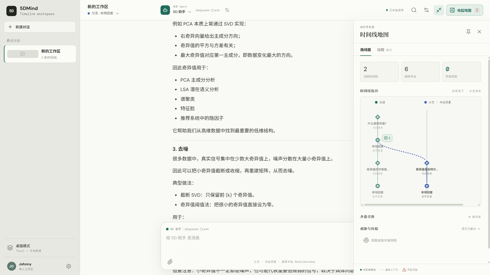
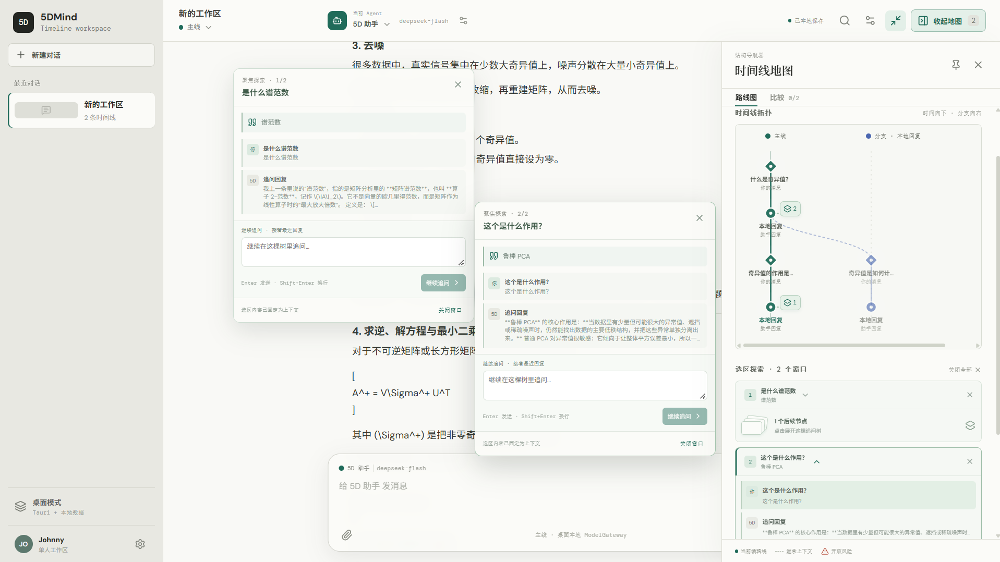

# 5DMind

> 将对话变成可分叉、可回溯、可并行推进的“时间线棋盘”。

适合用于聊天学习工具

5DMind 的核心不是简单普通的聊天工具，而是把每一条消息视为一个状态变化，把不同假设、不同回答和不同决策路径组织成可视化的时间线。用户可以在任意历史节点回到过去，创建分支，比较分支，并将有价值的分支合并回主线。

## 当前阶段

项目处于可运行桌面和移动端 MVP 阶段：React/Tauri 前端和 NestJS API 已具备独立构建目标。桌面端默认使用 Tauri command + SQLite 持久化，Provider 的 API URL、路径、模型和超时保存在应用设置中，桌面端 API Key 使用系统凭据库，Android 使用 Tauri 应用私有 SQLite 存储，iOS 使用 Keychain；OpenAI、Anthropic、Gemini、Ollama 和 OpenAI-compatible Provider 已接入本地 Rust ModelGateway，完整时间线上下文通过 Provider messages 发送，原生 SSE/NDJSON token 通过 Tauri IPC Channel 回传。未配置或连接失败时会显示明确错误，API Key 不会写入导出 JSON。Web 模式继续使用 IndexedDB，NestJS 远程模式仍是可选同步运行时，PostgreSQL + Drizzle schema 已准备但尚未接管云端运行时数据。产品边界、交互模型、技术架构和 MVP 验收标准见：

- [项目开发文档](docs/PROJECT_DEVELOPMENT.md)
- [技术架构与桌面打包](docs/ARCHITECTURE.md)
- [前后端对接文档](docs/BACKEND_INTEGRATION.md)
- [后端框架要求与架构设计](docs/BACKEND_ARCHITECTURE.md)
- [前后端集成状态与缺口](docs/INTEGRATION_STATUS.md)

## 本地开发

```bash
npm install
npm run dev:web
```

后端使用 NestJS 11 + Fastify 5，默认监听 `http://127.0.0.1:3000`：

```bash
npm run dev:api
npm run test:api
npm run build:api
```

前后端全量构建：

```bash
npm run build:all
```

Docker 启动 API 与 PostgreSQL：

```bash
docker compose up --build
```

健康检查位于 `/api/v1/health`，OpenAPI 3.1 JSON 位于 `/api/v1/openapi.json`。API 与 Tauri 安装包保持独立：桌面端默认通过 Tauri command 使用本地 SQLite，离线启动不需要 Node.js 或本机 HTTP 端口；联网同步时才通过 HTTPS REST + SSE 连接可选云端 API，不在 EXE 中嵌入 Node.js 服务。

桌面版使用 Tauri 2：

```bash
npm run dev:desktop
npm run build:desktop
```

Android 版本需要先安装 Android Studio、Android SDK、NDK 和 Java 21，并初始化 Tauri Android 目标：

```bash
npx tauri android init
npm run dev:android
npm run build:android
```

`build:android` 默认生成 arm64 APK 和 AAB。iOS 构建需要 macOS、Xcode 和 Apple 签名环境：

```bash
npx tauri ios init
npm run dev:ios
npm run build:ios
```

Windows 构建目标已配置为 NSIS 安装包与 MSI。桌面 MVP 使用 Tauri + SQLite 和系统凭据库，浏览器 Web 模式继续使用 IndexedDB；两者通过同一套领域服务接口复用 React 组件。当前 Release 验证已生成 NSIS 安装包；MSI 生成依赖本机 WiX `light.exe` 工具链。

## 核心术语

- **主线（Mainline）**：默认的对话路径。
- **分支（Branch）**：从某个历史节点派生出来的替代路径。
- **时间线（Timeline）**：一条有序的对话状态链。
- **节点（Node）**：一条消息、一次工具调用、一个用户决策或一个系统状态快照。
- **合并（Merge）**：将分支中的选定结论以明确的摘要或消息形式带回目标时间线。

## 设计原则

1. 对话内容优先，空间化表现服务于理解，不制造装饰性负担。
2. 任意操作都可解释、可撤销，不能让用户丢失原始上下文。
3. 首版优先解决“探索多个答案”和“保留上下文”，再扩展到多人协作和复杂自动化。


*主页对话*

*对回答进行追问*

